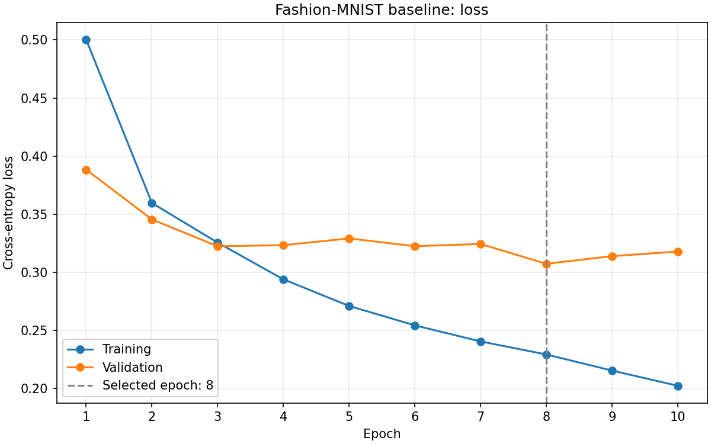
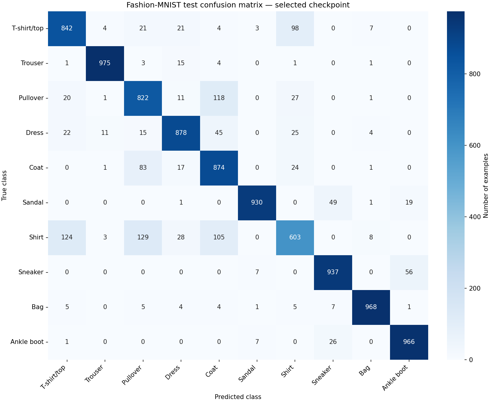

# Fashion-MNIST Classification with a Multilayer Perceptron

An project for exploring how a fully connected neural network classifies clothing images, and where a simple baseline makes mistakes. The workflow covers data preparation, training, validation-based checkpoint selection, and a separate final test evaluation. Results below are reported in the accompanying PDF; they were not regenerated during portfolio preparation.

## Data and approach

Fashion-MNIST contains 28 × 28 grayscale images in ten clothing categories. The official 60,000-image training set is split into 50,000 training and 10,000 validation examples; the official 10,000-image test set remains separate. Pixels are normalized using mean 0.2860 and standard deviation 0.3530.

The PyTorch MLP flattens each image and applies layers of 784 → 256 → 128 → 10 units, with ReLU hidden activations and 235,146 trainable parameters. Training uses cross-entropy loss, Adam with learning rate 0.001, batch size 128, and ten CPU epochs. The lowest validation loss selects the checkpoint, which is reloaded before testing. NumPy supports numerical work, scikit-learn computes classification metrics, and Matplotlib and Seaborn produce the figures.

## Key findings

- Test accuracy was **87.95%**: 8,795 correct predictions out of 10,000, with cross-entropy loss **0.340478** and macro F1 **0.8783**.
- Epoch **8** had the lowest validation loss, **0.307226**, and validation accuracy **88.64%**. Epoch 10 reached 89.12% validation accuracy but had higher loss, 0.317741.
- Shirt was the hardest category: recall **60.3%** and F1 **0.6764**. Of 397 shirt errors, 358 were predictions of Pullover, T-shirt/top, or Coat.
- Training loss fell from **0.5002 to 0.2022**, while validation loss later fluctuated around 0.31–0.33, indicating some overfitting.

## Results in context

*Report page 4: the widening loss gap explains why checkpoint selection matters; the dashed line marks epoch 8.*

*Report page 6: upper-body clothing accounts for prominent confusions, while trousers are classified more consistently.*

## Limitations

This is one MLP architecture without a hyperparameter search or a convolutional comparison. The report's identical-environment rerun checks reproducibility, not robustness across random seeds or platforms. Flattening images does not explicitly encode spatial structure.

